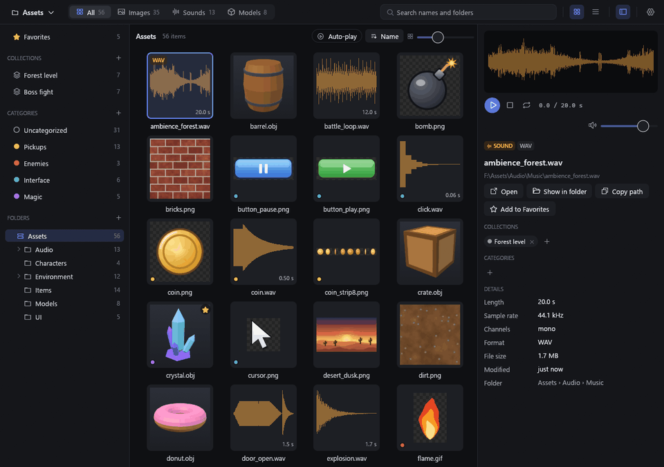
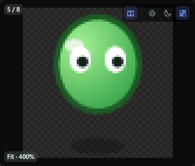
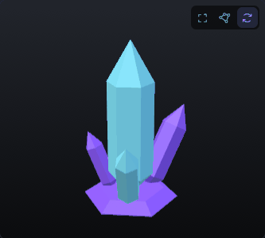
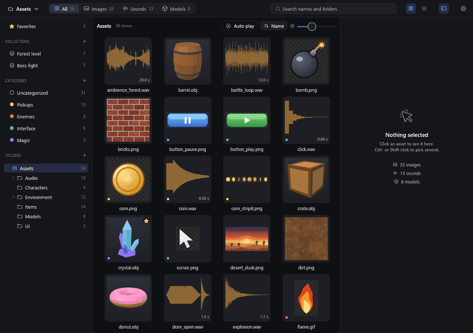
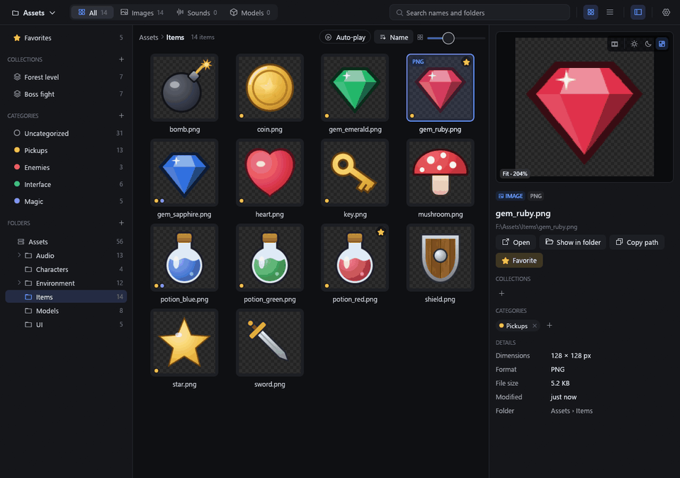

# Asset Browser

**A fast browser for folders of game assets.** Pictures, sprite sheets, sounds and 3D models side by side, each shown
large the moment you pick it. For Windows, written in Rust.


**[Download for Windows](https://github.com/Trashpanda-GameDev/Asset-Browser/releases/latest)** ·
[What it does](#what-it-does) · [Guide](docs/guide.md) · [What's new](CHANGELOG.md)

## What it does

### Keeps up with you

Arrow through a folder and each asset shows up at once in the preview pane: pictures, sounds with their waveforms, 3D
models, animations. Thumbnails are made once and kept, and the sounds after the one you're on are read ahead, so each
plays the moment you reach it.



### Plays animations, turns models

| | |
|:---:|:---:|
|  |  |
| **Sprite sheets and GIFs** play, with Aseprite or TexturePacker data, as GameMaker strips, or from the frames it finds itself | **3D models** in FBX, OBJ, glTF, STL, PLY, 3DS and Collada, with their materials, to turn around or set spinning |

### Shows sounds at a glance

Waveforms, lengths and formats in a list, and sounds play as you select them.


### Finds things as you type

Every word you type is matched against names, folders and categories.



### Stays current by itself

Copy files into your folders and they show up while the app is open: no rescanning, no restarting.



### Organizes without moving a file

Favorites, collections and coloured categories gather assets from all your folders.


The [guide](docs/guide.md) has the rest, from deleting to the Recycle Bin to your own keyboard shortcuts.

## Get it

Download it from [Releases](https://github.com/Trashpanda-GameDev/Asset-Browser/releases/latest), for 64-bit Windows 10
and 11: **TrashpandaAssetBrowser-win-Setup.exe** installs it (no admin rights needed), and
**TrashpandaAssetBrowser-win-Portable.zip** runs from wherever you unzip it. Both update themselves. Until the app is
signed, Windows warns about the download: **More info**, then **Run anyway**.

Then add your asset folders with **+** beside Folders, or drop them on the window: they're browsed together as one
library.

## Build it

With [Rust](https://rustup.rs) installed:

```
cargo run --release
```

[Working on it](docs/development.md) shows how the code is laid out and how it stays fast,
[how the code fits together](docs/architecture.md) has the rules it follows, and [releasing](docs/releasing.md) takes
one command, `npm run deploy`.
