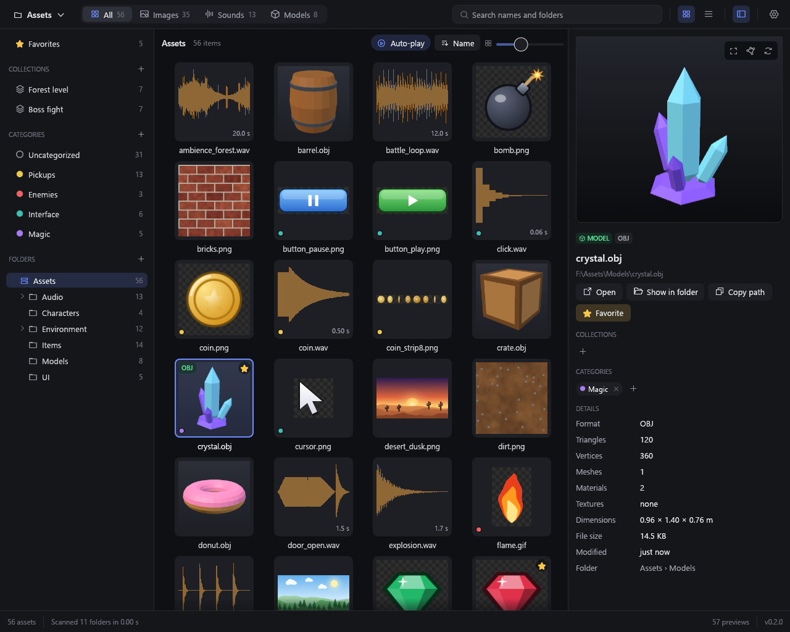
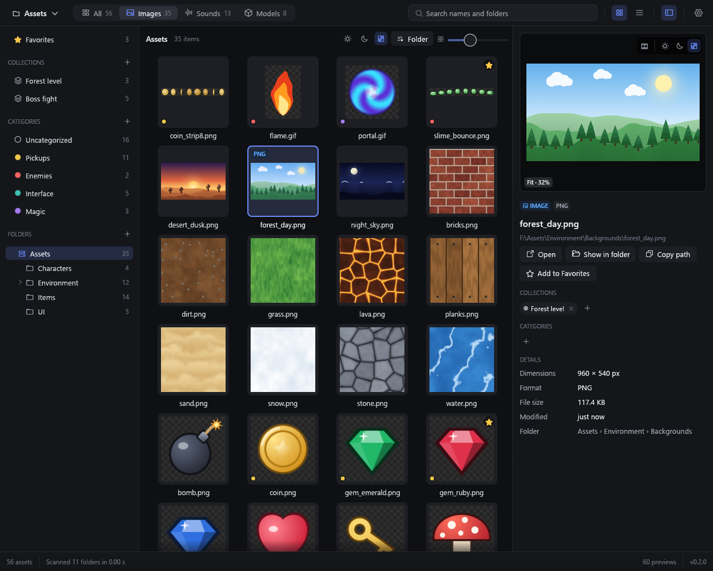
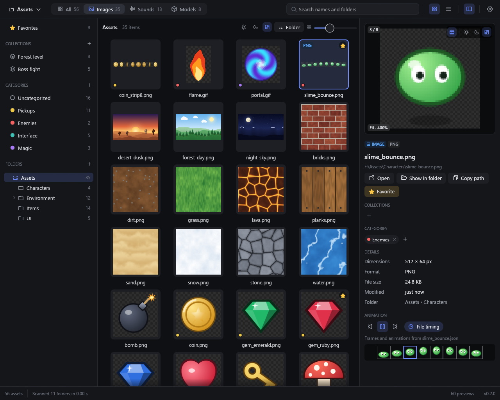
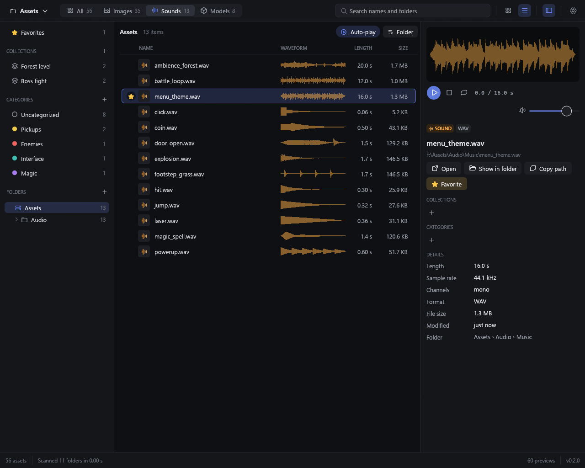
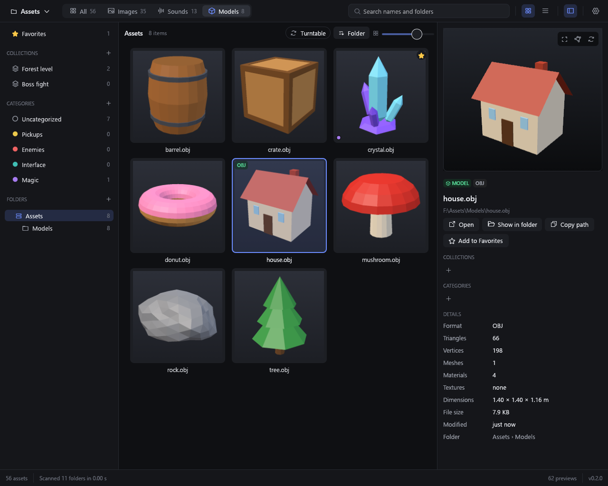
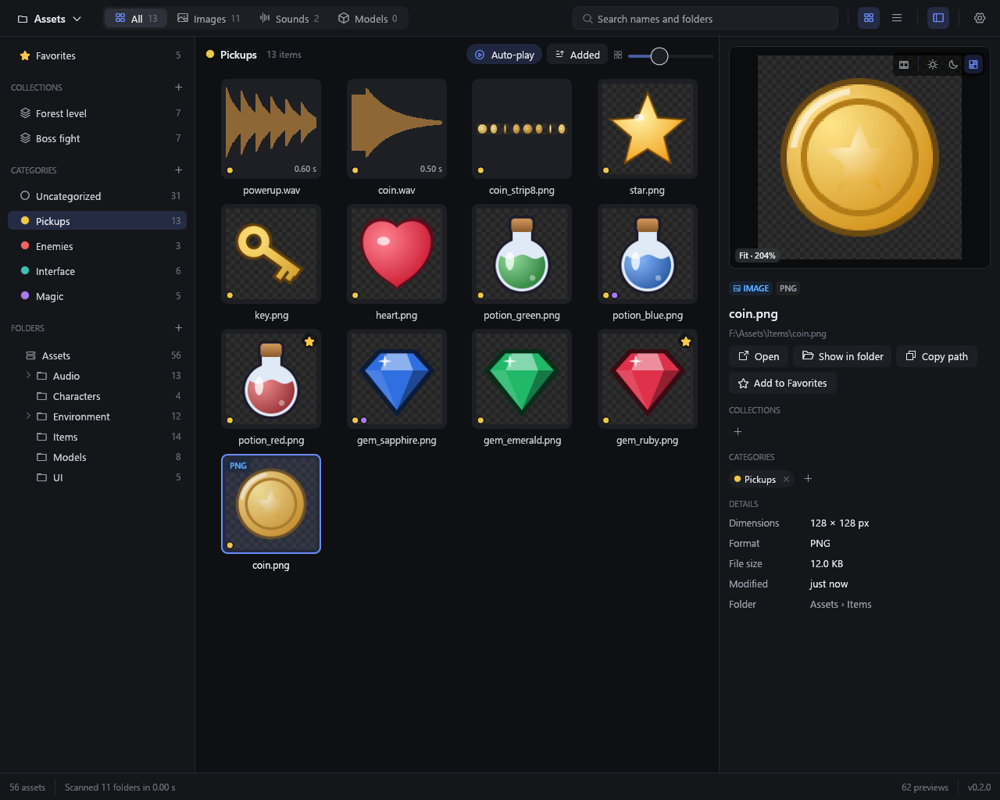
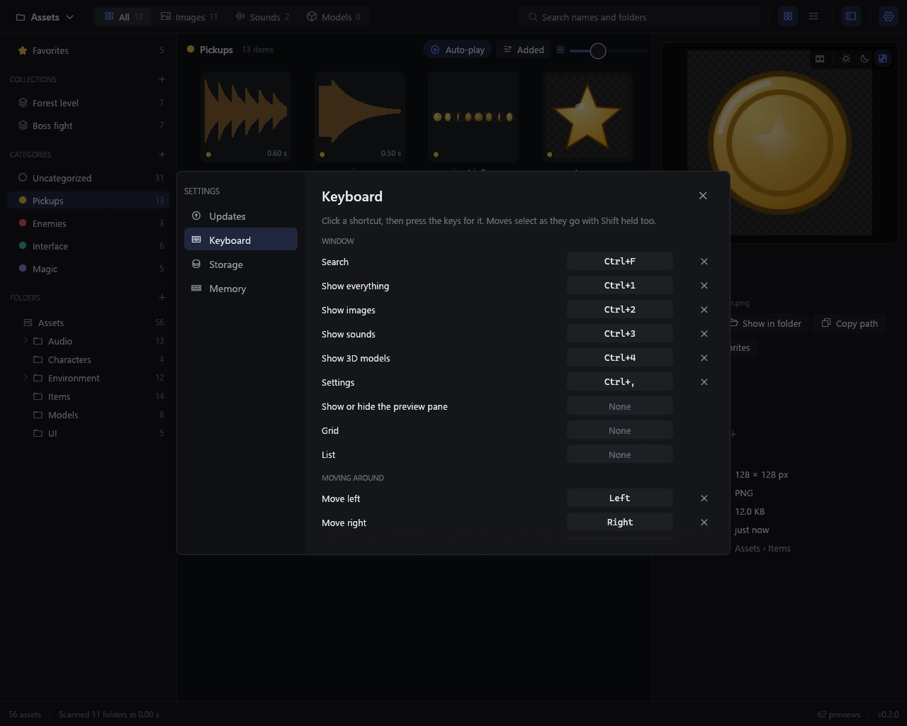

# Asset Browser

A fast browser for folders of game assets: pictures, sprite sheets, sounds and 3D models side by side, with a large
preview of whatever you pick. For Windows, written in Rust.



## Get it

Download it from [Releases](https://github.com/Trashpanda-GameDev/Asset-Browser/releases), for 64-bit Windows 10 and
11: **TrashpandaAssetBrowser-win-Setup.exe** installs it (no admin rights needed), and
**TrashpandaAssetBrowser-win-Portable.zip** runs from wherever you unzip it. Both update themselves. Until the app is
signed, Windows warns about the download: **More info**, then **Run anyway**.

Then add your asset folders with **+** beside Folders, or drop them on the window. They're browsed together as one
library, and files you add or change in them show up by themselves.

## What it does

| | |
|:---:|:---:|
| <br>**Pictures**, large in the preview pane to zoom and pan | <br>**Sprite sheets and GIFs** play as animations |
| <br>**Sounds** with their waveforms, played as you pick them | <br>**3D models** to turn around, with their materials |
| <br>**Favorites, collections and categories** across all your folders | <br>**Your own shortcuts**, and how much memory and disk it uses |

The [guide](docs/guide.md) has everything else it does, and every key.

## Build it

With [Rust](https://rustup.rs) installed:

```
cargo run --release
```

[Working on it](docs/development.md) shows how the code is laid out and how it stays fast, and
[releasing](docs/releasing.md) takes one command, `npm run deploy`. What's new in each version is in the
[changelog](CHANGELOG.md).
